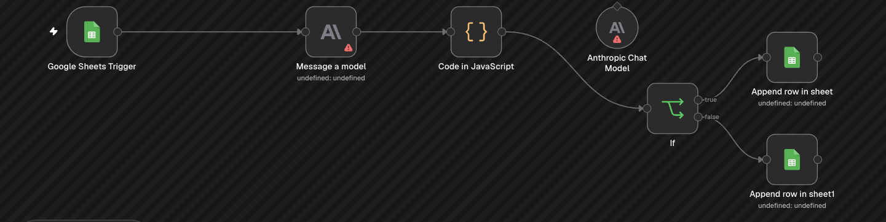

# Feedback triage with Claude (n8n)

A small automation that classifies incoming user feedback with an LLM and routes urgent items so they don't get lost in the pile.



## The problem
Feedback arrives in a shared Google Sheet. Someone has to read every entry, decide what kind of feedback it is and whether it needs attention now. That doesn't scale, and urgent issues sit next to "nice to have" ideas.

## How it works
1. **Google Sheets Trigger:** a new row in the feedback sheet starts the workflow.
2. **Claude (Haiku 4.5):** classifies each entry and returns JSON with
   - `category`: bug / feature-request / complaint / praise
   - `urgency`: low / medium / high
   - `summary`: one sentence, under 15 words
3. **Code (JavaScript):** cleans the model output and parses the JSON. If parsing fails, the entry is kept and marked `unparsed` instead of being dropped.
4. **If:** `urgency = high`?
   - **yes:** row is appended to the **Urgent** tab
   - **no:** row is appended to the **All feedback** tab

## Design choices
- **Structured output over free text:** the prompt asks for JSON only, so the next steps can route on fields instead of reading prose.
- **Fail safe, not fail silent:** unparseable answers are logged as `unparsed`, so a human can review them rather than losing feedback.
- **Small, cheap model:** classification is a simple task, so Haiku is enough.

## Prompt
```
Classify this piece of user feedback. Return ONLY valid JSON with these fields:
category (bug/feature-request/complaint/praise), urgency (low/medium/high),
summary (one sentence, under 15 words). Feedback: {{ $json.feedback_text }}
Do not include markdown code fences or any other text outside the JSON.
```

## Try it yourself
1. Import `workflow/feedback-triage.json` into n8n (Workflows → Import from file).
2. Create a Google Sheet with a `feedback_text` column plus two tabs for the output (urgent / all), and replace `YOUR_SPREADSHEET_ID`.
3. Connect your own Google Sheets and Anthropic credentials (none are included in this export).

## What I'd add next
- Measure classification accuracy on a hand-labelled sample before trusting the urgency flag.
- Notify a person (Slack or email) for urgent items instead of only writing to a tab.
- Add the original feedback text and a timestamp to the output rows.

---
Built by [Matteo Vercelli](https://github.com/Mttv0) · September 2026

